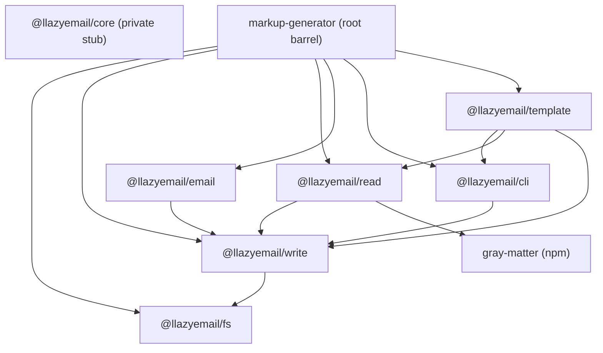

# Sub-package documentation (v4)

Reference docs for every package in this pnpm + Turborepo monorepo. Everything
here was written from the source in `packages/*/src` and `src/` at v4.0.0, so it
describes what the code does today, not what it should do. **Only the root
`markup-generator` package is published to npm**; `@llazyemail/*` modules stay
private and are bundled into it. For upgrading from v3, see
[MIGRATION.md](../../MIGRATION.md). For the original v4 plan, see
[docs/v4-monorepo.md](../v4-monorepo.md).

| Package | Published | Purpose | Doc |
|---------|-----------|---------|-----|
| `@llazyemail/fs` | **no (private; bundled)** | Directory and path helpers (`ensureDir`, `resolveFromCwd`, `pathExists`, `listTemplateFiles`) | [fs.md](./fs.md) |
| `@llazyemail/write` | **no (private; bundled)** | File writing, unique filenames, `MarkupGeneratorError` | [write.md](./write.md) |
| `@llazyemail/read` | **no (private; bundled)** | Text, front-matter and JSON reading, data/content loaders, `importEsm` | [read.md](./read.md) |
| `@llazyemail/email` | **no (private; bundled)** | `writeGeneratedEmail`, which writes to a stable filename and has an optional logger | [email.md](./email.md) |
| `@llazyemail/cli` | **no (private; bundled)** | `parseArgv`, `runCli` (logic behind the `markup-generator` bin) | [cli.md](./cli.md) |
| `@llazyemail/template` | **no (private; bundled)** | `generateTemplate`, `TemplateGenerator`, `createGenerator` | [template.md](./template.md) |
| `@llazyemail/core` | **no (private stub)** | Reserved-name stub | [core.md](./core.md) |
| `markup-generator` (root) | **yes (only public package)** | Self-contained package: bundles the above into `dist/`, plus `/browser` and the bin | [markup-generator.md](./markup-generator.md) |

## Architecture



An arrow means "depends on". `@llazyemail/core` has no dependencies and nothing
depends on it.

### Layers

1. **fs**: Node `fs`/`path` primitives and the shared `MarkupGeneratorError` /
   `DEFAULT_MESSAGES` (leaf package so fs/read/write can throw without a cycle).
2. **write**: file writing helpers; re-exports the error type from fs.
3. **read / email / cli**: built on top of write (read also depends on `gray-matter`).
4. **template**: combines cli (argv parsing), read (data loading) and write.
5. **root (`markup-generator`)**: the only published package — bundles the above
   into `dist/`, adds `markup-generator/browser` and the `markup-generator` bin.
   Consumers should `npm install markup-generator` and import from
   `'markup-generator'` / `'markup-generator/browser'`.

### Build order

Turborepo (`turbo.json`) uses `build.dependsOn: ["^build"]`, so the topological
order is:

1. `@llazyemail/fs`, `@llazyemail/core` (no dependencies)
2. `@llazyemail/write`
3. `@llazyemail/read`, `@llazyemail/email`, `@llazyemail/cli` (in parallel)
4. `@llazyemail/template`
5. `markup-generator` (root)

`test` depends on the package's own `build`, and `typecheck` depends on `^build`.

### Common commands

```bash
pnpm install
pnpm turbo:build                                  # turbo run build (all packages)
pnpm turbo:test                                   # turbo run test
pnpm --filter @llazyemail/write build             # one package
pnpm --filter @llazyemail/write test
pnpm --filter @llazyemail/write typecheck
pnpm publish:dry                                  # dry-run; only root publishes (scoped pkgs private)
```

> **Consumers:** do not `pnpm add @llazyemail/…` from npm — those packages are
> private workspace modules. Use `npm install markup-generator`.

Each package builds with
`tsup src/index.ts --no-config --format esm,cjs --dts --clean --target node20 --platform node`.
The output goes to `dist/index.js` (ESM), `dist/index.cjs` (CJS) and
`dist/index.d.ts`. All packages require Node `>=20`. Their `lint` scripts are
placeholders for now.

## Deprecations (removal in v5)

| Deprecated | Package | Replacement |
|------------|---------|-------------|
| `writeHTML(fileName, data, dir?, _message?)` | `@llazyemail/write` | `writeGeneratedFile({ fileName, content, dir })` |
| `isFolderExists(dir)` | `@llazyemail/fs` | `ensureDir(dir)` |

`writingFile` was **removed** in v4. Use `writeGeneratedFile({ content, prefix })` instead.
