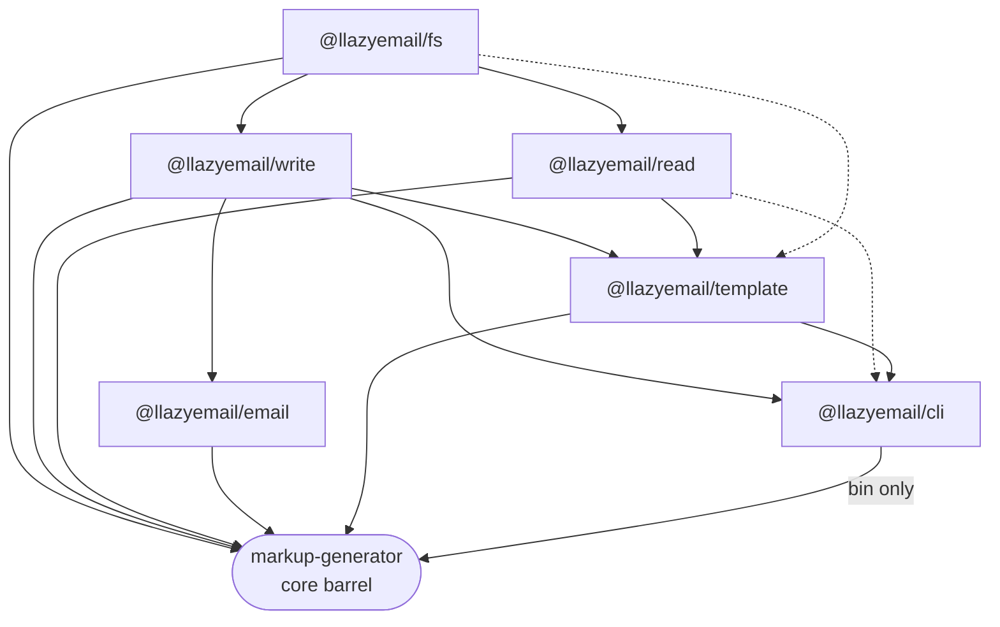

# markup-generator v4 upgrade plan

Monorepo split under `@llazyemail/*`, one root publish as `markup-generator`, with CI build order and a clear migration path. Decisions from Arthur; revise this page as we execute.

Related implementation notes (phase-by-phase extraction detail): [v4-monorepo.md](./v4-monorepo.md).

Sources: [repo](https://github.com/LLazyEmail/markup-generator), [#272](https://github.com/LLazyEmail/markup-generator/issues/272), [#278](https://github.com/LLazyEmail/markup-generator/issues/278).

## Contents

- [Decisions locked](#decisions-locked)
- [Target package map](#target-package-map)
- [Dependency graph](#dependency-graph)
- [Repo layout](#repo-layout)
- [CI and publish](#ci-and-publish)
- [Migration and breaking changes](#migration-and-breaking-changes)
- [Phased rollout](#phased-rollout)
- [Open issues to close or retarget](#open-issues-to-close-or-retarget)
- [Follow-ups shipped](#follow-ups-shipped)
- [Still open](#still-open)

> **North star:** Keep publishing `markup-generator` on npm, but stop growing one flat barrel. Split by concern into small packages, assemble them in a core package, and make CI build leaves before the root.

## Decisions locked

| Decision | Choice |
|----------|--------|
| Publish model | Root `markup-generator` plus scoped `@llazyemail/*` packages |
| Scope | `@llazyemail/*` |
| Tooling | pnpm workspaces + Turborepo |
| API policy | v4 may break the flat API; ship `MIGRATION.md` |
| gray-matter | Only in `@llazyemail/read` |
| Template APIs | `TemplateGenerator` + `generateTemplate` → `@llazyemail/template` |
| Email wrapper | `writeGeneratedEmail` → `@llazyemail/email` |
| Nx remnant | Drop completely (`write/` scaffold) |
| `old/` folder | Convert into future-facing documentation, not delete blind |

## Target package map

Each package owns one concern, has its own tests, and builds before anything that depends on it. Names below are the proposed publish names.

| Package | Owns | Notes |
|---------|------|-------|
| `@llazyemail/fs` | `ensureDir`, `resolveFromCwd`, `pathExists`, `listTemplateFiles` | No gray-matter |
| `@llazyemail/write` | `writeGeneratedFile`, `generateFileName`, `MarkupGeneratorError`, `DEFAULT_MESSAGES` | Original WRITE charter |
| `@llazyemail/read` | `readSourceFile`, `readFrontMatter`, `readJson`/`writeJson`, `loadData`, `loadContent` | Sole home of gray-matter |
| `@llazyemail/email` | `writeGeneratedEmail` | Logging / `exitCode` policy on top of write |
| `@llazyemail/cli` | bin `markup-generator`, `parseArgv`, CLI commands | Depends on write/read/template as needed |
| `@llazyemail/template` | `generateTemplate`, `TemplateGenerator`, `createGenerator` | Orchestration; not FS primitives |
| `markup-generator` | Re-exports the public surface consumers want | Root package; depends on the packages above |

Optional later: keep `./browser` as a root (or write) subpath exporting only `generateFileName`, matching today.

## Dependency graph

Turborepo `dependsOn: ["^build"]` enforces leaf → mid → core. Dashed edges are soft or optional depending on how we split shared types.

## Repo layout

Keep the structure flat and obvious. One workspace root, packages under `packages/`, docs from the old code under `docs/`.

- `package.json` + `pnpm-workspace.yaml` + `turbo.json` at root
- `packages/fs`, `packages/write`, `packages/read`, `packages/email`, `packages/cli`, `packages/template`
- `packages/markup-generator` (or root package) as the published barrel + bin wiring
- Each package: `src/`, `tests/`, own `tsup` (or shared config), own Vitest project
- Delete `write/` Nx remnant entirely
- Move useful `old/` material into `docs/` (history / design notes); do not leave dead JS as product code
- Drop `.obsidian/` from the product tree if it is not intentional docs tooling

## CI and publish

1. **Install with pnpm** — Single lockfile; GitHub Actions uses pnpm + cache. Node >=20 unchanged.
2. **`turbo run test` / `build`** — `^build` so fs/write/read build before email/template/cli, then core. Fail the job if any package fails tests.
3. **Publish** — Update `npm-publish.yml` for a coordinated release: publish `@llazyemail/*` then `markup-generator` (same version or workspace protocol). Prefer Changesets or an explicit release script so order never drifts.
4. **Verify consumers** — Smoke: import from `markup-generator` and from `@llazyemail/write` in a tiny fixture after publish dry-run.

## Migration and breaking changes

Root may stop re-exporting every symbol from one barrel, or re-export a narrower set. Document both paths in `MIGRATION.md`.

| Today | v4 guidance |
|-------|-------------|
| `writeGeneratedFile` / `generateFileName` | Prefer `@llazyemail/write`; still available from root if we keep a compatibility barrel |
| `writeGeneratedEmail` | `@llazyemail/email` (addresses overlap called out in #270) |
| `readFrontMatter` / `loadData` | `@llazyemail/read` (pulls gray-matter only when needed) |
| `generateTemplate` / `TemplateGenerator` | `@llazyemail/template` |
| `writeHTML` / `writingFile` / `isFolderExists` | Drop or hard-deprecate; point to write + fs names |
| CLI bin `markup-generator` | Ships from root or `@llazyemail/cli`; same command names if possible |

## Phased rollout

- [x] **Phase 0 — Scaffold** — Done in [PR #279](https://github.com/LLazyEmail/markup-generator/pull/279) — pnpm + turbo stubs; source still at root
- [x] **Phase 1 — Move primitives** — Done in [PR #282](https://github.com/LLazyEmail/markup-generator/pull/282) — `@llazyemail/fs` + `@llazyemail/write`; root re-exports
- [x] **Phase 2 — Read + gray-matter** — Done in [PR #285](https://github.com/LLazyEmail/markup-generator/pull/285) — gray-matter only on `@llazyemail/read`
- [x] **Phase 3 — Email + template + cli** — Done in [PR #286](https://github.com/LLazyEmail/markup-generator/pull/286) — email, template, cli packages; writes via `@llazyemail/write`
- [x] **Phase 4 — Core barrel + MIGRATION.md** — Done in [PR #287](https://github.com/LLazyEmail/markup-generator/pull/287) — 4.0.0, publish dry-run OK; npm scope + trusted publishers still needed
- [x] **Phase 5 — Housekeeping** — Done in [PR #288](https://github.com/LLazyEmail/markup-generator/pull/288) — drop Nx remnant; `old/` → docs; issue retargets

## Open issues to close or retarget

1. [#272 Re-organization Version #4](https://github.com/LLazyEmail/markup-generator/issues/272)
2. [#278 gray-matter](https://github.com/LLazyEmail/markup-generator/issues/278)
3. [#270 write vs writeEmail](https://github.com/LLazyEmail/markup-generator/issues/270)
4. [#241 / #153 old folder](https://github.com/LLazyEmail/markup-generator/issues/241)
5. [#266 loadDataModule](https://github.com/LLazyEmail/markup-generator/issues/266)
6. [#17 injectable save methods](https://github.com/LLazyEmail/markup-generator/issues/17)

## Follow-ups shipped

Merged after Phase 5 (all on main as of 2026-10-27 Europe/Sofia):

- chore/eslint — [PR #292](https://github.com/LLazyEmail/markup-generator/pull/292)
- feat/template-render-html — [PR #293](https://github.com/LLazyEmail/markup-generator/pull/293)
- fix/cli-argv-parser — [PR #294](https://github.com/LLazyEmail/markup-generator/pull/294)
- fix/error-codes-causes — [PR #295](https://github.com/LLazyEmail/markup-generator/pull/295)
- fix/main-warnings — [PR #297](https://github.com/LLazyEmail/markup-generator/pull/297)
- renovate eslint 10 — [PR #296](https://github.com/LLazyEmail/markup-generator/pull/296)
- renovate pnpm 12 — [PR #283](https://github.com/LLazyEmail/markup-generator/pull/283)

## Still open

- Exact root re-export list vs thin compatibility shim
- Whether `@llazyemail/cli` is a dependency of the root or only provides the bin via the root `package.json`
- Shared types package vs co-locate types in write
- Release tooling: Changesets vs manual coordinated publish
- Whether to keep deprecated aliases for one minor after 4.0
- Review sub-package documentation (`docs/packages/` / docs PR) — the dedicated review issue was still pending create when this plan was written
- **Claim / configure the `@llazyemail` npm org** and grant packages publish access
- **Trusted publishing** (OIDC) for GitHub Actions → npm so releases do not rely on long-lived tokens
- No production npm publish yet (dry-run only; see [v4-monorepo.md](./v4-monorepo.md))

---

Next: review `docs/packages/` against current main (template HTML render, CLI parser, error codes landed after the docs PR).
